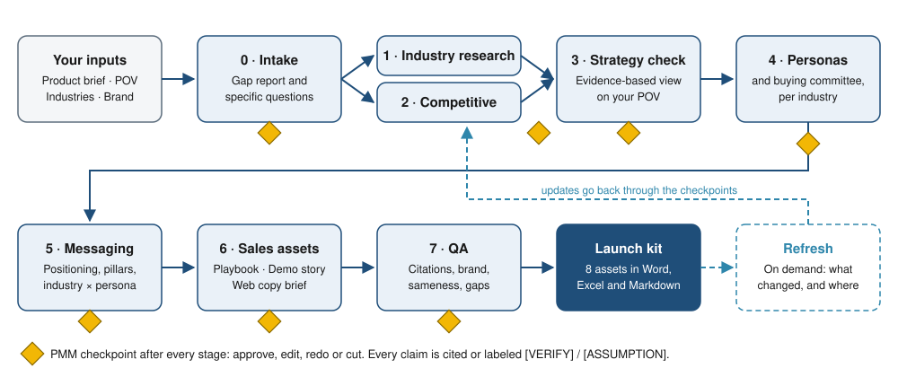

# Industry Launch Accelerator

**Turn a product brief into a sourced, industry-specific launch kit, with the PMM in charge.**

Every launch starts with the same groundwork: industry research, personas, competitive intel and messaging, repeated for every industry you sell into. This toolkit gets that groundwork in place, sourced and ready to edit, so PMMs can spend their time on the strategic calls. [Why I built it](docs/design-decisions.md)

You bring the product brief and your point of view; an AI coding agent does the research and the first drafts, stopping for your approval after every stage. Every claim is cited or labeled.



| What goes in | What comes out (Word, Excel and Markdown) |
|---|---|
| Product brief (a template to fill in) | 1. Industry brief, per industry |
| Your launch POV, in your own words | 2. Battlecards, per competitor, plus a competitive overview |
| Target industries | 3. Strategy check: an evidence-based view on your POV |
| Brand guidelines (optional) | 4. Personas and buying committee, per industry |
| Anything else useful: PRDs, win/loss notes, transcripts | 5. Messaging framework, with an industry × persona grid in Excel |
| | 6. Industry playbook, per industry |
| | 7. Demo storyline, per industry |
| | 8. Webpage copy brief, per industry |
| | `LAUNCH-KIT.md`: an index with status, open items and the top 10 things to verify |

---

## How it works in 60 seconds

- **It runs in the AI coding agent you already use:** Claude Code, Codex, Cursor or similar. The toolkit is a folder of plain instructions, templates and small scripts. Nothing is hosted, and nothing leaves your computer except the agent's own web searches and public data requests.
- **You stay in charge.** After every stage the agent stops and summarizes. You **approve**, **edit**, **redo** with direction, or **cut** items. Nothing moves forward without you (unless you switch on auto mode).
- **It asks instead of inventing.** Missing essentials become specific questions (at most 7 per round). Missing extras become labeled assumptions.
- **It tells you where it disagrees.** After research, the *strategy check* compares your launch POV with the evidence: agree, disagree, partly agree, or "add". You respond to each point, and everything after follows your resolved direction.
- **Every claim is traceable.** Facts carry a source like `[S12]`. Anything else is marked `[ASSUMPTION]`, `[VERIFY]` or `[PROOF NEEDED]`. Customer proof is never invented.
- **Industry-specific, not find-and-replace.** Each industry gets its own trends, buyers, pains and story. QA flags personas or messages that are too alike across industries.
- **It stays current.** Ask the agent to "refresh the launch" at any time: it checks competitor news, new regulation, updated market data and broken sources, and tells you exactly which assets and sections are affected.

---

## Quickstart

You don't need to know Git or Python. You'll copy and paste a few commands, once.

### 1. Install Python (once)

1. Go to [python.org/downloads](https://www.python.org/downloads/) and click the yellow **Download Python** button.
2. Open the downloaded file and follow the installer.
   - **Windows:** tick **"Add python.exe to PATH"** on the first screen, then click **Install Now**.
   - **Mac:** when it finishes, a Finder window opens. Double-click **"Install Certificates.command"** in it.

### 2. Get the toolkit

**Easiest:** on this page, click the green **Code** button → **Download ZIP**. Unzip it somewhere you'll find again, for example your Documents folder.

**Or with Git:**

```bash
git clone https://github.com/nolina-m/industry-launch-accelerator.git
```

### 3. Run setup (once)

Setup creates a private Python environment inside the folder, installs what the toolkit needs, and checks which public data sources are available.

**Mac:** open the **Terminal** app, type `cd ` (with a space), drag the toolkit folder into the Terminal window, press Enter, then paste:

```bash
./setup.sh
```

**Windows:** open the toolkit folder in File Explorer, click the address bar, type `powershell` and press Enter, then paste:

```powershell
powershell -ExecutionPolicy Bypass -File .\setup.ps1
```

You should see `[OK] Setup complete.`

### 4. Open the folder in your coding agent

- **Claude Code** (desktop app or terminal): open the toolkit folder as your project. Claude Code reads the toolkit's instructions automatically.
- **Codex:** open the folder (`codex` in a terminal inside the folder, or the Codex app). For fresh research, turn on live web search: add `web_search = "live"` to `~/.codex/config.toml`.
- **Cursor:** open the folder, and use the chat in **Agent** mode. Make sure the web search tool is switched on in Cursor's settings.

### 5. Start a launch

Say to the agent:

> start a new launch called *my product launch*

It creates `launches/my-product-launch/` and tells you what to fill in:

1. `inputs/product-brief.md`: the template explains each field. Leave anything you don't know empty; the agent will ask.
2. `inputs/launch-pov.md`: your point of view, a few sentences to half a page, including your target industries.
3. Optional: put supporting documents in `inputs/brief/`, brand files (brand book, Word template, PNG logos) in `inputs/brand/`, and win/loss notes, transcripts or existing messaging in `inputs/optional/`.

Then say **"inputs are ready"**. The agent takes it from there, one stage and one checkpoint at a time.

### 6. Optional: switch on more data sources

22 public data sources work with no sign-up: SEC filings, Wikipedia, GitHub, the Federal Register, EU law (EUR-Lex), BLS, the World Bank, the OECD, CMS, openFDA, the FDIC and more. Six more switch on with a free key (Census, FRED, Regulations.gov, Congress.gov, SAM.gov and Currents news):

1. Open the file called `.env` in the toolkit folder with any text editor. Setup created it; on a Mac, press Cmd+Shift+. in Finder to see files starting with a dot.
2. Each key has a line explaining where to sign up. Paste the key after the `=` sign and save.
3. To see what's switched on, ask the agent to "check the data sources", or run:

```bash
.venv/bin/python scripts/connectors/check.py
```

Also add your email to `ILA_CONTACT_EMAIL=` if you want SEC filings: SEC asks every user to identify themselves. Your `.env` file never leaves your computer. Full list: [docs/data-sources.md](docs/data-sources.md).

---

## Working with the kit

- **Where things are:** every asset is in `launches/<name>/outputs/`, in Markdown and Word (plus the Excel messaging grid). Open `LAUNCH-KIT.md` for the index.
- **Making changes:** tell the agent in chat, or edit the Markdown files. If you edit a Markdown file, the agent notices before the next stage, shows you what changed, and copies it into the kit's data so it isn't lost. **Edits in Word or Excel are not copied back.** Make lasting changes in chat or Markdown, and polish in Word at the very end.
- **Refreshing:** ask the agent to "refresh the launch". You get `refresh/<date>/what-changed.md`, and each update goes through its normal checkpoint.
- **PDF:** open the Word file (or upload it to Google Docs) and save as PDF.
- **Several launches** can live side by side in `launches/`. Each one is self-contained: zip its folder to share it.
- **Auto mode:** say "turn on auto mode" to skip the checkpoints. Every asset is then labeled "Not reviewed by PMM". Missing essentials still stop the run.

## What it won't do

- **Recommend prices.** It reports how competitors price (the model, not numbers to copy).
- **Invent customer names, quotes, logos or metrics.** Proof slots stay `[PROOF NEEDED]` until you supply real proof.
- **Name competitors in customer-facing copy** (demo and web copy), unless you opt in.
- **Use paid data or bypass paywalls.** It only uses public sources whose terms allow business use.
- **Make slides or PDFs, or publish anything.** It drafts; you decide what ships.

## Example runs

Example runs coming soon.

## Learn more

- [Design decisions](docs/design-decisions.md): why it works this way
- [Customization](docs/customization.md): industry packs, data sources, Word templates
- [Data sources](docs/data-sources.md): what's included, how it was checked, what was left out and why
- [Compatibility](docs/compatibility.md): which agents and systems it has been run on
- [Contributing](CONTRIBUTING.md)

## About the author

I'm Nolina Mishra, a product marketer in San Francisco. As a founding PMM, I took AI and XR products to B2B and B2C buyers, building each go-to-market from scratch. I built this toolkit to get the groundwork of a launch in place, so PMMs can spend more of their time on the strategic calls.

[nolina.work](https://nolina.work) · [LinkedIn](https://www.linkedin.com/in/nolinamishra)

## License

[MIT](LICENSE) © 2026 Nolina Mishra
