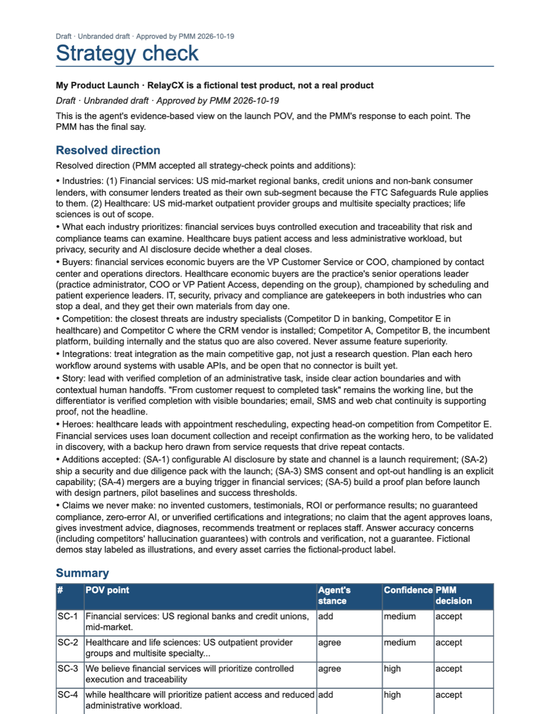
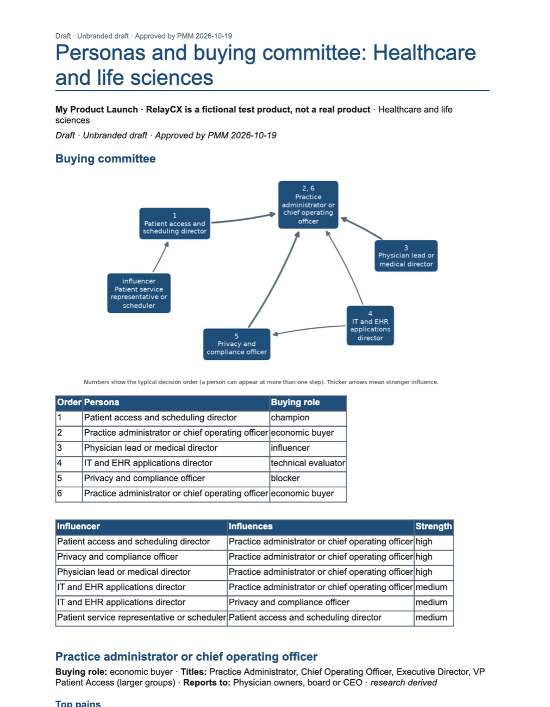
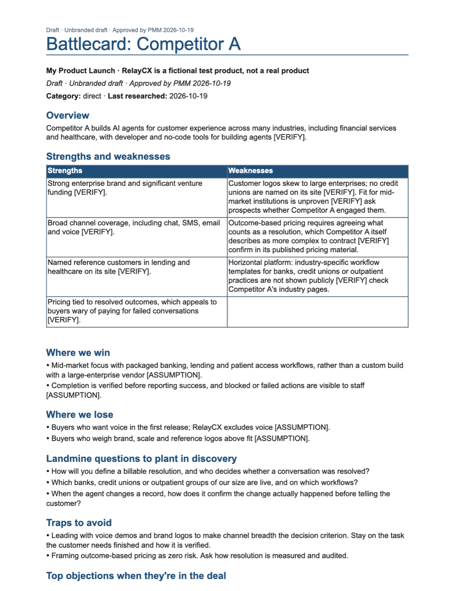
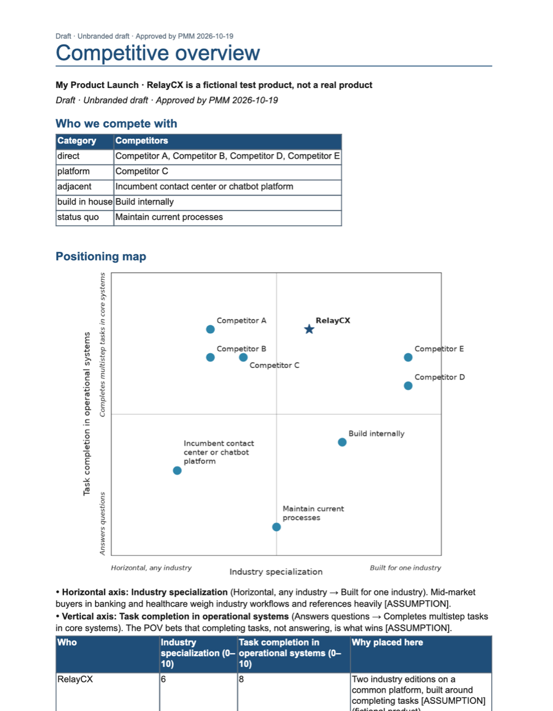
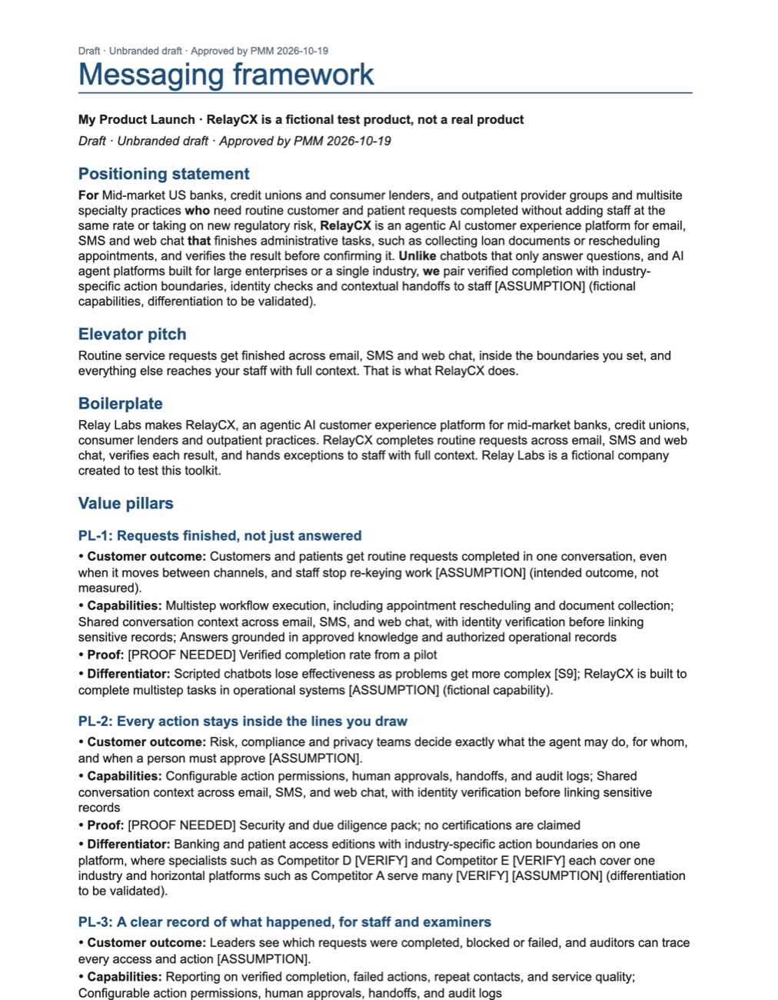
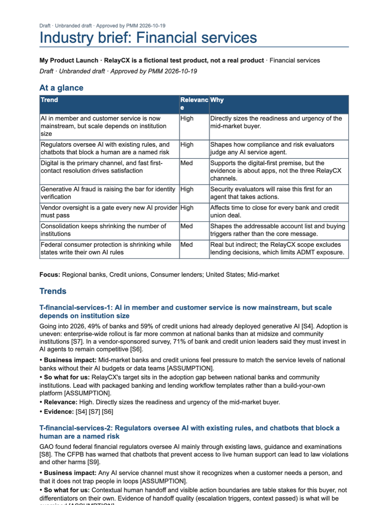
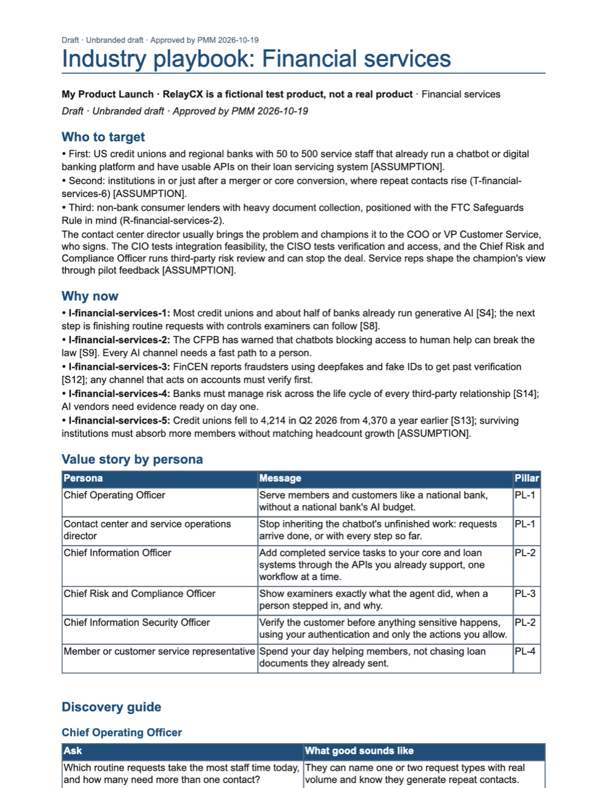
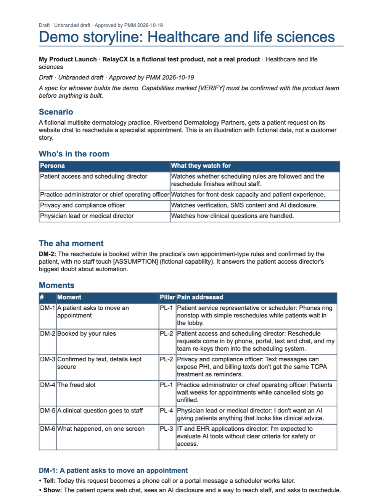
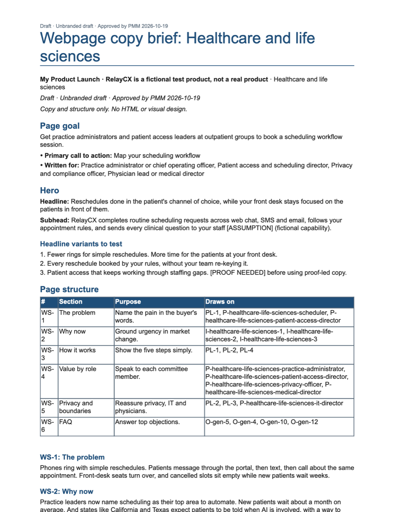

# Example: RelayCX launch kit

A complete kit produced with Industry Launch Accelerator for **RelayCX, a fictional agentic AI customer service product** from a fictional company, Relay Labs. It covers two industries, US mid-market financial services and outpatient healthcare, and eight competitors, with every stage approved at its checkpoint.

**Start with [LAUNCH-KIT.md](LAUNCH-KIT.md)**, the index of the whole kit, or open any asset below.

> **About this example**
> - RelayCX and Relay Labs are fictional. Every capability is an assumption made for the test, and there are no customers, quotes or results; proof slots say `[PROOF NEEDED]`.
> - The research is real and cited (see the [source register](research/sources.json)).
> - **Five real competitors were renamed Competitor A–E for this public example.** Their sources, funding figures, customer names, list prices and recent moves were removed, and the claims that lost their source are marked `[VERIFY]`.
> - It's a first draft, exactly as the toolkit produces it. [QA](qa-report.md) found 0 errors and 98% citation coverage. Its warnings are left in on purpose, to show what the checks catch.

## The assets

| | Asset | Financial services | Healthcare |
|---|---|---|---|
| 1 | Industry brief | [Read](outputs/01-industry-brief-financial-services.md) | [Read](outputs/01-industry-brief-healthcare-life-sciences.md) |
| 2 | Battlecards and competitive overview | [Overview](outputs/02-competitive-overview.md) · [Competitor A](outputs/02-battlecard-competitor-a.md) · [B](outputs/02-battlecard-competitor-b.md) · [C](outputs/02-battlecard-competitor-c.md) · [D](outputs/02-battlecard-competitor-d.md) · [E](outputs/02-battlecard-competitor-e.md) · [Incumbent platform](outputs/02-battlecard-incumbent-platform.md) · [Build in-house](outputs/02-battlecard-build-in-house.md) · [Status quo](outputs/02-battlecard-status-quo.md) | (shared) |
| 3 | Strategy check | [Read](outputs/03-strategy-check.md) | (shared) |
| 4 | Personas and buying committee | [Read](outputs/04-personas-financial-services.md) | [Read](outputs/04-personas-healthcare-life-sciences.md) |
| 5 | Messaging framework | [Read](outputs/05-messaging-framework.md) | (shared) |
| 6 | Industry playbook | [Read](outputs/06-playbook-financial-services.md) | [Read](outputs/06-playbook-healthcare-life-sciences.md) |
| 7 | Demo storyline | [Read](outputs/07-demo-storyline-financial-services.md) | [Read](outputs/07-demo-storyline-healthcare-life-sciences.md) |
| 8 | Webpage copy brief | [Read](outputs/08-web-copy-financial-services.md) | [Read](outputs/08-web-copy-healthcare-life-sciences.md) |

**Word and Excel files:** every asset as `.docx`, plus the messaging grid as `.xlsx`, is in `relaycx-example-word-excel.zip`, attached to the [latest release](https://github.com/nolina-m/industry-launch-accelerator/releases/latest).

## What went in

The PMM's inputs: the [product brief](inputs/product-brief.md), the [launch POV](inputs/launch-pov.md) and the [answers to the intake questions](inputs/intake-answers.md). The kit's [gap report](gap-report.md) shows the questions the agent asked first.

## Pages from the Word files

| | |
|---|---|
|  **Strategy check:** the agent's evidence-based view of the POV, and the PMM's response to each point |  **Personas and buying committee** (healthcare) |
|  **Battlecard** (Competitor A) |  **Competitive overview** with the positioning map |
|  **Messaging framework** |  **Industry brief** (financial services) |
|  **Industry playbook** (financial services) |  **Demo storyline** (healthcare) |
|  **Webpage copy brief** (healthcare) | |
