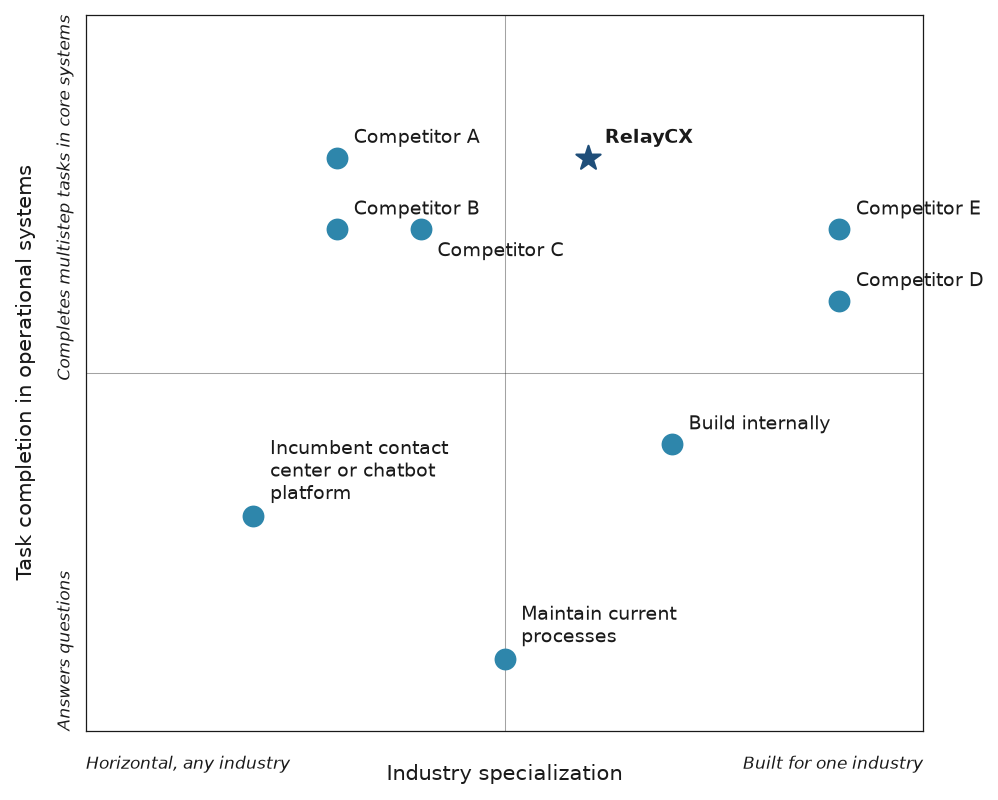

# Competitive overview

**My Product Launch · RelayCX is a fictional test product, not a real product**

_Draft · Unbranded draft · Approved by PMM 2026-10-19_

## Who we compete with

| Category | Competitors |
|---|---|
| direct | Competitor A, Competitor B, Competitor D, Competitor E |
| platform | Competitor C |
| adjacent | Incumbent contact center or chatbot platform |
| build in house | Build internally |
| status quo | Maintain current processes |

## Positioning map

- **Horizontal axis: Industry specialization** (Horizontal, any industry → Built for one industry). Mid-market buyers in banking and healthcare weigh industry workflows and references heavily [ASSUMPTION].
- **Vertical axis: Task completion in operational systems** (Answers questions → Completes multistep tasks in core systems). The POV bets that completing tasks, not answering, is what wins [ASSUMPTION].

| Who | Industry specialization (0–10) | Task completion in operational systems (0–10) | Why placed here |
|---|---|---|---|
| RelayCX | 6 | 8 | Two industry editions on a common platform, built around completing tasks [ASSUMPTION] (fictional product). |
| Competitor A | 3 | 8 | Horizontal, many industries [VERIFY]; outcome pricing implies task resolution [VERIFY]. Placement [ASSUMPTION]. |
| Competitor B | 3 | 7 | Horizontal with fintech strength [VERIFY]. Placement [ASSUMPTION]. |
| Competitor C | 4 | 7 | Horizontal platform with industry templates [VERIFY]. Placement [ASSUMPTION]. |
| Competitor D | 9 | 6 | Banking and credit unions only [VERIFY]. Placement [ASSUMPTION]. |
| Competitor E | 9 | 7 | Healthcare patient access only [VERIFY]. Placement [ASSUMPTION]. |
| Incumbent contact center or chatbot platform | 2 | 3 | Scripted bots answer basic questions [S9]. Placement [ASSUMPTION]. |
| Build internally | 7 | 4 | Tailored to the institution but limited by data readiness [S5]. Placement [ASSUMPTION]. |
| Maintain current processes | 5 | 1 | Staff complete tasks manually [ASSUMPTION]. |

## Strongest by industry

| Industry | Strongest | Notes |
|---|---|---|
| Financial services | Competitor D, Competitor C | Competitor D is built for banks and credit unions with a large base of institutions [VERIFY]. Competitor C has banking service templates and an installed CRM base [VERIFY]. Competitor A lists lending customers on its site [VERIFY]. |
| Healthcare and life sciences | Competitor E, Competitor A | Competitor E targets patient access and rebooking in the EHR [VERIFY]. Competitor A lists healthcare customers on its site [VERIFY]. Outsourced service (BPO) is also an alternative some groups use [ASSUMPTION], covered here without a battlecard as agreed at intake. |

## Common objections (any competitor)

### "We don't have budget for this cycle."

- **Underlying concern:** Budget timing.
- **Usually from:** CFO, COO
- **Acknowledge:** Budgets are set, and new line items are hard.
- **Reframe:** Start with one workflow where staff time and repeat contacts can be measured.
- **Evidence:** [PROOF NEEDED] Pilot baseline and success thresholds.
- **Ask back:** Which workflow costs your team the most time per month?
- **Proof:** [PROOF NEEDED] Cost-of-inaction model.

### "We're fine with how things work today."

- **Underlying concern:** Change risk.
- **Usually from:** COO
- **Acknowledge:** If service levels are acceptable, change must earn its place.
- **Reframe:** Look at repeat contacts and handoffs, not just whether requests are eventually handled.
- **Evidence:** Patient access roles remain turnover hotspots [S23]; most credit unions have deployed generative AI [S4].
- **Ask back:** How many requests need more than one contact to finish?
- **Proof:** [PROOF NEEDED] Repeat-contact baseline.

### "We'd rather build than buy."

- **Underlying concern:** Control and cost.
- **Usually from:** CIO
- **Acknowledge:** Building gives control.
- **Reframe:** The controls around the model are the expensive part to build and validate.
- **Evidence:** Data readiness is a known gap at community institutions [S5].
- **Ask back:** Who would own permissions, logs and handoffs after launch?
- **Proof:** [PROOF NEEDED] Build-versus-buy comparison.

### "Security and compliance will take months to approve this."

- **Underlying concern:** Third-party and privacy review.
- **Usually from:** CISO, Compliance, Procurement
- **Acknowledge:** Reviews are required and should be thorough [S14].
- **Reframe:** Prepare the review evidence up front, so it doesn't become the bottleneck.
- **Evidence:** Banks must manage risk across the third-party life cycle [S14]; healthcare vendors face business associate scrutiny [S34].
- **Ask back:** What does your review team need first?
- **Proof:** [PROOF NEEDED] Due diligence pack; no certifications are claimed today.

### "Integrating with our core or practice management system is too hard."

- **Underlying concern:** Integration effort.
- **Usually from:** IT
- **Acknowledge:** Integrations are often where projects stall.
- **Reframe:** Start where an API exists and widen from there.
- **Evidence:** [VERIFY] No RelayCX integration is built yet.
- **Ask back:** Which systems expose APIs for the workflow you'd pilot?
- **Proof:** [PROOF NEEDED] Integration plan per system.

### "Our staff won't adopt another tool."

- **Underlying concern:** Change management.
- **Usually from:** Contact center director, Patient access manager
- **Acknowledge:** Tool fatigue is real.
- **Reframe:** Staff see handoffs with context rather than a new tool to learn [ASSUMPTION].
- **Evidence:** [PROOF NEEDED] Staff feedback from a pilot.
- **Ask back:** What would make a handoff useful to your team?
- **Proof:** [PROOF NEEDED] Handoff quality results.

### "You're a new vendor. Will you be around?"

- **Underlying concern:** Vendor viability.
- **Usually from:** Procurement, CFO
- **Acknowledge:** It's a fair question for any new vendor.
- **Reframe:** Look at data portability and exit terms, as well as funding.
- **Evidence:** [PROOF NEEDED] Relay Labs funding and references.
- **Ask back:** What exit terms would make you comfortable?
- **Proof:** [PROOF NEEDED] Viability evidence.

### "AI makes things up."

- **Underlying concern:** Accuracy and hallucination.
- **Usually from:** Compliance, CRO
- **Acknowledge:** Generative AI can produce wrong answers.
- **Reframe:** Limit answers to approved knowledge and authorized records, and verify actions before confirming them.
- **Evidence:** [ASSUMPTION] Proposed controls, not verified implementation. RelayCX must not claim zero errors.
- **Ask back:** How do you catch a wrong answer from staff today?
- **Proof:** [PROOF NEEDED] Accuracy evaluation results.

### "We can't control the AI's tone or brand."

- **Underlying concern:** Brand and tone control.
- **Usually from:** Digital experience leader
- **Acknowledge:** Tone matters, especially in sensitive conversations.
- **Reframe:** Use approved knowledge, templates and escalation rules for sensitive topics [ASSUMPTION] (fictional capability).
- **Evidence:** [ASSUMPTION] Proposed configuration.
- **Ask back:** Which topics should always go to a person?
- **Proof:** [PROOF NEEDED] Sample transcripts.

### "Will our customer or patient data be used to train your models?"

- **Underlying concern:** Data privacy and training.
- **Usually from:** Privacy officer
- **Acknowledge:** Data use is a reasonable concern.
- **Reframe:** Data use should be defined in the contract.
- **Evidence:** [VERIFY] Relay Labs data-use policy is undefined.
- **Ask back:** What data-use terms does your privacy team require?
- **Proof:** [PROOF NEEDED] Written data-use policy.

### "Regulators won't accept an AI agent in this process."

- **Underlying concern:** Compliance in regulated industries.
- **Usually from:** Compliance
- **Acknowledge:** Regulators are watching AI in service channels.
- **Reframe:** Regulators apply existing rules [S8]; design for a human path [S9] and examinable logs.
- **Evidence:** Regulators oversee AI through existing laws and exams [S8]; chatbots that block human support are a stated risk [S9].
- **Ask back:** Which rules worry your compliance team most?
- **Proof:** [PROOF NEEDED] Compliance review by a specialist. Not legal advice.

### "This will replace our staff."

- **Underlying concern:** Workforce impact.
- **Usually from:** COO, HR
- **Acknowledge:** Staff and leaders will ask this.
- **Reframe:** RelayCX is for routine requests so staff handle exceptions; it does not replace staff.
- **Evidence:** [ASSUMPTION] Intended outcome, not a measured result.
- **Ask back:** Which work would your team rather not do?
- **Proof:** [PROOF NEEDED] Staff capacity results.

### "We'll just build it on an LLM API."

- **Underlying concern:** Build on a general model.
- **Usually from:** CIO, IT
- **Acknowledge:** Model APIs are powerful and easy to start with.
- **Reframe:** Production service agents need identity checks, permissions, approvals, consent handling and logs.
- **Evidence:** Data readiness is a known gap [S5].
- **Ask back:** How long to build and validate those controls?
- **Proof:** [PROOF NEEDED] Build-versus-buy comparison.

## Before you use this

- **[VERIFY]:** 13 · **[ASSUMPTION]:** 17 · **[PROOF NEEDED]:** 16

Items to verify:

- Horizontal, many industries [VERIFY]; outcome pricing implies task resolution [VERIFY]. Placement [ASSUMPTION].
- Horizontal with fintech strength [VERIFY]. Placement [ASSUMPTION].
- Horizontal platform with industry templates [VERIFY]. Placement [ASSUMPTION].
- Banking and credit unions only [VERIFY]. Placement [ASSUMPTION].
- Healthcare patient access only [VERIFY]. Placement [ASSUMPTION].
- Competitor D is built for banks and credit unions with a large base of institutions [VERIFY]. Competitor C has banking service templates and an installed CRM base [VERIFY]. Competitor A lists lending customers on its ...
- Competitor E targets patient access and rebooking in the EHR [VERIFY]. Competitor A lists healthcare customers on its site [VERIFY]. Outsourced service (BPO) is also an alternative some groups use [ASSUMPTION], covere...
- [VERIFY] No RelayCX integration is built yet.
- [VERIFY] Relay Labs data-use policy is undefined.

## Sources

- **[S4]** What's Going On in Banking Research Finds AI, Crypto, and Fraud Are Top of Mind for Banking Executives in 2026, Cornerstone Advisors (2026-01-29; retrieved 2026-10-19; tier 2). https://www.crnrstone.com/press-release/cornerstone-advisors-whats-going-on-in-banking-research-finds-ai-crypto-and-fraud-are-top-of-mind-for-banking-executives-in-2026
- **[S5]** Cornerstone's 2026 Banking Outlook: For Credit Unions, It's Not A Year To Chase Shiny Objects, CU Today (2026-01-29; retrieved 2026-10-19; tier 2). https://www.cutoday.info/THE-feature/Cornerstone-s-2026-Banking-Outlook-For-Credit-Unions-It-s-Not-A-Year-To-Chase-Shiny-Objects
- **[S8]** Artificial Intelligence: Use and Oversight in Financial Services (GAO-25-107197), U.S. Government Accountability Office (2025-05-19; retrieved 2026-10-19; tier 1). https://www.gao.gov/products/GAO-25-107197
- **[S9]** Chatbots in consumer finance (Issue Spotlight), Consumer Financial Protection Bureau (2023-06-06; retrieved 2026-10-19; tier 1). https://www.consumerfinance.gov/data-research/research-reports/chatbots-in-consumer-finance/
- **[S14]** Interagency Guidance on Third-Party Relationships: Risk Management, Federal Register (Federal Reserve, FDIC, OCC) (2023-06-09; retrieved 2026-10-19; tier 1). https://www.federalregister.gov/documents/2023/06/09/2023-12340/interagency-guidance-on-third-party-relationships-risk-management
- **[S23]** Stabilized but not solved: Staff turnover in 2026, MGMA (2026-05-28; retrieved 2026-10-19; tier 2). https://www.mgma.com/mgma-stat/stabilized-but-not-solved-staff-turnover-in-2026
- **[S34]** OCR announces 11th and 12th Risk Analysis Initiative enforcement actions, McDonald Hopkins (undated; retrieved 2026-10-19; tier 2). https://www.mcdonaldhopkins.com/insights/news/ocr-announces-risk-analysis-initiative-enforcement-actions

---

_Draft generated with Industry Launch Accelerator on 2026-10-19. Verify items marked [VERIFY] before external use._
