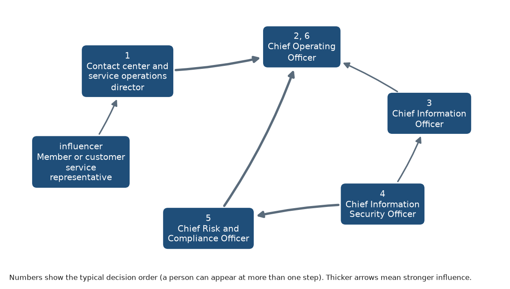

# Personas and buying committee: Financial services

**My Product Launch · RelayCX is a fictional test product, not a real product** · Financial services

_Draft · Unbranded draft · Approved by PMM 2026-10-19_

## Buying committee

| Order | Persona | Buying role |
|---|---|---|
| 1 | Contact center and service operations director | champion |
| 2 | Chief Operating Officer | economic buyer |
| 3 | Chief Information Officer | technical evaluator |
| 4 | Chief Information Security Officer | influencer |
| 5 | Chief Risk and Compliance Officer | blocker |
| 6 | Chief Operating Officer | economic buyer |

| Influencer | Influences | Strength |
|---|---|---|
| Contact center and service operations director | Chief Operating Officer | high |
| Chief Risk and Compliance Officer | Chief Operating Officer | high |
| Chief Information Officer | Chief Operating Officer | medium |
| Chief Information Security Officer | Chief Risk and Compliance Officer | high |
| Chief Information Security Officer | Chief Information Officer | medium |
| Member or customer service representative | Contact center and service operations director | medium |

## Chief Operating Officer

**Buying role:** economic buyer · **Titles:** Chief Operating Officer, EVP Operations, VP Customer Service, VP Member Experience (credit unions) · **Reports to:** Chief Executive Officer · _research derived_

### Top pains

1. National banks are scaling AI in service faster than we can, and we don't have their budgets or data teams. _(linked to T-financial-services-1, I-financial-services-1, I-financial-services-5)_
2. Service volume grows with every merger and new product, but headcount can't grow at the same rate. _(linked to T-financial-services-6, T-financial-services-1, I-financial-services-5)_
3. Any AI in a customer channel must survive examiners and our board, so pilots stall before they reach members or customers. _(linked to T-financial-services-2, T-financial-services-5, I-financial-services-1, I-financial-services-4)_

### What they own

- **Responsibilities:** Branch, contact center and loan operations; Efficiency ratio and operating budget; Merger integration and system conversions [ASSUMPTION]
- **KPIs:** Efficiency ratio and cost to serve; Complaint volume and member or customer satisfaction; Regulatory findings and audit issues
- **Goals:** Absorb growth without adding service staff at the same rate; Show the board a controlled, examinable AI program; Keep complaint volume flat or falling

### How they buy

- **Buying triggers:** A merger or core conversion that adds members, systems and repeat contacts [ASSUMPTION]; Board or strategic planning push on AI; A peer institution announcing an AI service deployment [ASSUMPTION]
- **Objections:** Our examiners will need to see this first; We tried a chatbot and members hated it; Budget is set for this year
- **Must believe to buy:** Routine requests can be completed without adding regulatory risk; Staff will move to complex work rather than being cut; The vendor will still be here and supporting us in three years
- **Where they learn:** American Bankers Association and America's Credit Unions; Cornerstone Advisors research; American Banker and CU Today; Peer CEOs and COOs in state associations [ASSUMPTION]

### Language

- **Use:** members (credit unions), efficiency ratio, controls, audit trail, risk appetite
- **Avoid:** disrupt, replace staff, fully autonomous, compliant out of the box

### Discovery questions

1. Which routine requests take the most staff time today, and how many of them need more than one contact?
2. How did your board and examiners respond the last time you introduced a new digital service?
3. What does your growth plan for the next two years assume about service headcount?
4. If an AI agent completed one workflow end to end, which would you want it to be, and why?
5. What would you need to see in a pilot to expand it to the rest of the institution?

## Contact center and service operations director

**Buying role:** champion · **Titles:** Director of Contact Center, Member Services Director, VP Service Operations, Loan Servicing Manager (consumer lenders) · **Reports to:** COO or VP Customer Service · _research derived_

### Top pains

1. Customers start in one channel and finish in another, and my team asks them to repeat everything. _(linked to T-financial-services-3, I-financial-services-2)_
2. Our chatbot answers questions but can't finish anything, so its conversations land in my queue anyway. _(linked to T-financial-services-2, T-financial-services-1, I-financial-services-1, I-financial-services-2)_
3. When a request is half done, nobody can see which step failed or who owns it. _(linked to T-financial-services-5, I-financial-services-4)_

### What they own

- **Responsibilities:** Phone, chat, email and SMS queues; Staffing, quality and training; Escalations and complaints
- **KPIs:** First-contact resolution; Average handle time and service level; Repeat-contact rate; Agent attrition
- **Goals:** Raise first-contact resolution; Give agents full context on every handoff; Free experienced agents for complex cases

### How they buy

- **Buying triggers:** Rising repeat contacts or complaint spikes; Seasonal volume peaks such as tax season or rate changes [ASSUMPTION]; Losing experienced agents
- **Objections:** My agents will spend more time fixing the bot's mistakes; We'll lose control of tone with members; Another tool for agents to learn
- **Must believe to buy:** Handoffs will arrive with context and identity status, so agents start where the AI stopped; The agent will escalate rather than guess; I'll see completed, blocked and failed actions in one place
- **Where they learn:** Contact center peer groups and conferences [ASSUMPTION]; Vendor case studies; CU Today and The Financial Brand

### Language

- **Use:** first-contact resolution, handoff, queue, repeat contacts, members
- **Avoid:** deflection, headcount reduction, set and forget

### Discovery questions

1. Walk me through the last request that bounced between email, phone and chat before it was finished.
2. What happens today when your chatbot can't answer: what does the agent see?
3. Which requests would your best agents happily never handle again?
4. How do you find out a promised follow-up didn't happen?
5. What would a handoff need to contain for your team to trust it?

## Chief Information Officer

**Buying role:** technical evaluator · **Titles:** Chief Information Officer, CTO, Director of Digital Banking, VP Enterprise Architecture · **Reports to:** COO or Chief Executive Officer · _research derived_

### Top pains

1. Our core and loan systems are hard to integrate, and every new vendor adds another fragile connection. _(linked to T-financial-services-1, I-financial-services-1)_
2. Data quality isn't ready for AI, and I'll be blamed if the agent acts on bad records. _(linked to T-financial-services-1, I-financial-services-4)_
3. I'm asked to build AI in-house without the engineers to maintain it. _(linked to T-financial-services-1, T-financial-services-6, I-financial-services-5)_

### What they own

- **Responsibilities:** Core banking, loan origination and servicing systems; Digital banking and CRM; Vendor integrations and data
- **KPIs:** Project delivery against plan; System uptime; Integration and maintenance cost
- **Goals:** Add AI services without re-platforming; Keep integrations supportable by a small team; Clear ownership of data and permissions

### How they buy

- **Buying triggers:** Core contract renewal or conversion [ASSUMPTION]; Digital banking upgrade; Board request for an AI roadmap
- **Objections:** Our core can't integrate with this; We'd rather build on our existing platform; Who maintains the integration when our core vendor changes its API?
- **Must believe to buy:** Integrations use supported APIs and the vendor maintains them; Permissions are configurable per action, not all or nothing; We can start with one system and expand
- **Where they learn:** Cornerstone Advisors research; Core vendor user groups [ASSUMPTION]; American Banker technology coverage

### Language

- **Use:** core, API, integration, least privilege, data quality
- **Avoid:** rip and replace, plug and play, no IT needed

### Discovery questions

1. Which systems would an agent need to read from and write to for your highest-volume request?
2. Where do your core and loan servicing systems expose usable APIs today?
3. How have past integrations held up when a vendor changed versions?
4. Who owns data quality for the records service staff rely on?
5. What would make you choose to buy rather than build here?

## Chief Risk and Compliance Officer

**Buying role:** blocker · **Titles:** Chief Risk Officer, Chief Compliance Officer, BSA Officer, Third-Party Risk Manager · **Reports to:** Chief Executive Officer and the board risk committee · _research derived_

### Top pains

1. Examiners apply existing rules to AI, so I have to prove an agent won't trap customers or mishandle disputes. _(linked to T-financial-services-2, I-financial-services-2, I-financial-services-4)_
2. Every new AI vendor adds third-party risk work, monitoring and evidence I have to keep current. _(linked to T-financial-services-5, I-financial-services-4)_
3. State AI and consent rules keep changing while federal supervision is in flux. _(linked to T-financial-services-7, I-financial-services-4)_

### What they own

- **Responsibilities:** Third-party risk management; Consumer compliance, including UDAAP and TCPA; Model risk and AI governance; Exam preparation
- **KPIs:** Exam findings; Open audit issues; Complaint trends; Third-party reviews completed on time
- **Goals:** No exam findings from new channels; Clear, current evidence for every vendor; AI governance the board understands

### How they buy

- **Buying triggers:** Exam scheduled or recent findings; New state law affecting AI or messaging; A vendor incident at a peer [ASSUMPTION]
- **Objections:** Model risk management will need to validate this AI; Third-party review takes months; How do you handle a customer who disputes a charge in chat?
- **Must believe to buy:** Every action is logged and attributable; The agent recognizes disputes and complaints and hands them to people; Due diligence evidence is ready before the review starts
- **Where they learn:** Federal Register and regulator guidance; GAO and CFPB reports; Law-firm alerts such as Ballard Spahr's Consumer Finance Monitor

### Language

- **Use:** controls, supervisory expectations, audit trail, third-party risk, consent
- **Avoid:** guaranteed compliant, regulator approved, zero risk

### Discovery questions

1. What would your third-party risk review need from an AI vendor on day one?
2. How does your model risk process treat an agent that takes actions, not just one that answers questions?
3. Which customer requests must always reach a person?
4. How do you capture and honor SMS opt-outs across channels today?
5. What evidence would make an examiner comfortable with this channel?

## Chief Information Security Officer

**Buying role:** influencer · **Titles:** Chief Information Security Officer, Information Security Officer, Fraud and Identity Manager · **Reports to:** CIO or Chief Risk Officer · _research derived_

### Top pains

1. Fraudsters use deepfakes and fake IDs to get past our verification, and a text channel that can act on accounts is a new target. _(linked to T-financial-services-4, I-financial-services-3)_
2. Vendors want broad access to customer records when they need only a few actions. _(linked to T-financial-services-5, T-financial-services-4, I-financial-services-3, I-financial-services-4)_
3. I can't see what an AI did with customer data after the fact. _(linked to T-financial-services-5, I-financial-services-4)_

### What they own

- **Responsibilities:** Security program and vendor security reviews; Authentication and fraud controls; Incident response
- **KPIs:** Security incidents; Fraud losses; Vendor security review findings
- **Goals:** Verification before any sensitive action; Least-privilege access for every vendor; Full logs for incident response

### How they buy

- **Buying triggers:** A fraud spike or account takeover incident; FinCEN or regulator alert on new fraud types; Annual vendor security review
- **Objections:** We can't send customer data to an outside provider; Text channels are easy to spoof; Show me your security documentation
- **Must believe to buy:** The agent uses our existing authentication, not its own; It can only take the actions we allow; Every access and action is logged and exportable
- **Where they learn:** FinCEN alerts; FS-ISAC and peer security groups [ASSUMPTION]; Vendor security questionnaires

### Language

- **Use:** authentication, least privilege, allowlist, account takeover, logging
- **Avoid:** unbreakable, bank-grade security, fully secure

### Discovery questions

1. How do you verify identity today before changing anything on an account in a digital channel?
2. Which fraud patterns worry you most in text-based channels?
3. What access does a typical service vendor get to customer records?
4. What logs would you need after an incident?
5. What would fail a vendor in your security review?

## Member or customer service representative

**Buying role:** end user · **Titles:** Member Service Representative, Customer Service Specialist, Loan Servicing Specialist · **Reports to:** Contact center supervisor · _research derived_

### Top pains

1. I re-verify and re-ask questions the customer already answered in another channel. _(linked to T-financial-services-3, I-financial-services-2)_
2. Chasing missing loan documents means repeated emails and calls that pull me off live contacts. _(linked to T-financial-services-1, T-financial-services-6, I-financial-services-5)_
3. When the chatbot hands over, I get the customer, not the history. _(linked to T-financial-services-2, I-financial-services-2)_

### What they own

- **Responsibilities:** Answering calls, chats, emails and texts; Updating records and cases; Chasing documents and follow-ups
- **KPIs:** Handle time; Quality scores; Cases closed
- **Goals:** Start every case with full context; Spend time on members who need help; Fewer follow-up tasks to track

### How they buy

- **Buying triggers:** Queue backlogs; New process or system rollouts
- **Objections:** Will it make mistakes I have to clean up?; Is this here to replace us?
- **Must believe to buy:** The agent hands over with everything I need; It takes the repetitive follow-ups off my plate; It won't promise things I then have to undo
- **Where they learn:** Supervisors and team leads; Internal training

### Language

- **Use:** case, member, follow-up, handoff
- **Avoid:** automation will handle it, efficiency gains

### Discovery questions

1. What part of your day is spent chasing information customers already gave someone?
2. What do you see when a customer moves from chat to phone?
3. Which follow-ups do you most often lose track of?
4. When would you want the system to hand a conversation to you right away?
5. What would make you trust a summary written by an AI?

## Before you use this

- **[VERIFY]:** 0 · **[ASSUMPTION]:** 10 · **[PROOF NEEDED]:** 0

## Sources

No sources cited.

---

_Draft generated with Industry Launch Accelerator on 2026-10-19. Verify items marked [VERIFY] before external use._
