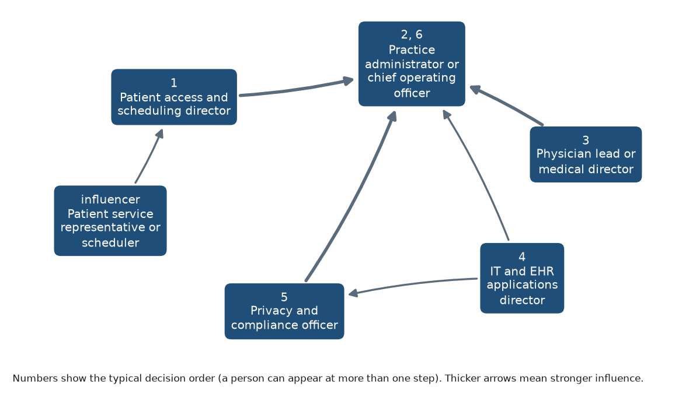

# Personas and buying committee: Healthcare and life sciences

**My Product Launch · RelayCX is a fictional test product, not a real product** · Healthcare and life sciences

_Draft · Unbranded draft · Approved by PMM 2026-10-19_

## Buying committee

| Order | Persona | Buying role |
|---|---|---|
| 1 | Patient access and scheduling director | champion |
| 2 | Practice administrator or chief operating officer | economic buyer |
| 3 | Physician lead or medical director | influencer |
| 4 | IT and EHR applications director | technical evaluator |
| 5 | Privacy and compliance officer | blocker |
| 6 | Practice administrator or chief operating officer | economic buyer |

| Influencer | Influences | Strength |
|---|---|---|
| Patient access and scheduling director | Practice administrator or chief operating officer | high |
| Privacy and compliance officer | Practice administrator or chief operating officer | high |
| Physician lead or medical director | Practice administrator or chief operating officer | high |
| IT and EHR applications director | Practice administrator or chief operating officer | medium |
| IT and EHR applications director | Privacy and compliance officer | medium |
| Patient service representative or scheduler | Patient access and scheduling director | medium |

## Practice administrator or chief operating officer

**Buying role:** economic buyer · **Titles:** Practice Administrator, Chief Operating Officer, Executive Director, VP Patient Access (larger groups) · **Reports to:** Physician owners, board or CEO · _research derived_

### Top pains

1. Front-desk and patient access seats keep turning over, and every vacancy backs up phones and scheduling. _(linked to T-healthcare-life-sciences-1, I-healthcare-life-sciences-1)_
2. Patients wait weeks for appointments while cancelled slots go unfilled. _(linked to T-healthcare-life-sciences-3, I-healthcare-life-sciences-2)_
3. I want AI at the front desk, but I can't risk a privacy incident or a state disclosure violation. _(linked to T-healthcare-life-sciences-5, T-healthcare-life-sciences-6, I-healthcare-life-sciences-3, I-healthcare-life-sciences-4)_

### What they own

- **Responsibilities:** Practice operations and staffing; Patient access and revenue cycle; Vendor contracts and budget
- **KPIs:** Staff turnover and overtime; Appointment fill rate and no-shows [ASSUMPTION]; Days in accounts receivable; Patient experience scores
- **Goals:** Stable patient access capacity despite turnover; Fill freed slots quickly; Adopt AI with privacy and disclosure handled

### How they buy

- **Buying triggers:** Front-desk vacancies or rising overtime; New location or provider additions [ASSUMPTION]; Patient complaints about phone access
- **Objections:** It has to work with our practice management system; We need a business associate agreement and a security review; Show me results at a practice like ours
- **Must believe to buy:** Routine scheduling requests get completed without staff touching them; Clinical questions always reach staff; Privacy, consent and disclosure are configured for every state we operate in
- **Where they learn:** MGMA and MGMA Stat polls; State medical group associations [ASSUMPTION]; Peer administrators

### Language

- **Use:** patient access, fill rate, front desk, no-shows, staff capacity
- **Avoid:** replace your front desk, AI doctor, fully autonomous

### Discovery questions

1. How many patient access positions turned over in the past year, and what happened to phone wait times?
2. What happens to a cancelled appointment slot today?
3. Which locations or specialties have the longest new-patient waits?
4. What would your physician owners need to hear before approving an AI tool at the front desk?
5. How do you handle AI disclosure in the states where you operate?

## Patient access and scheduling director

**Buying role:** champion · **Titles:** Director of Patient Access, Scheduling Manager, Patient Experience Manager, Call Center Manager · **Reports to:** Practice Administrator or COO · _research derived_

### Top pains

1. Reschedule requests come in by phone, portal, text and chat, and my team re-keys them into the scheduling system. _(linked to T-healthcare-life-sciences-2, T-healthcare-life-sciences-4, I-healthcare-life-sciences-1, I-healthcare-life-sciences-2)_
2. Cancelled slots sit empty because nobody has time to work the waitlist. _(linked to T-healthcare-life-sciences-3, I-healthcare-life-sciences-2)_
3. I lose trained schedulers faster than I can replace them. _(linked to T-healthcare-life-sciences-1, I-healthcare-life-sciences-1)_

### What they own

- **Responsibilities:** Scheduling across providers and locations; Patient calls, portal and text messages; Referral and waitlist management
- **KPIs:** Phone abandonment rate; Time to next available appointment; No-show and late-cancel rates; Staff productivity
- **Goals:** Fewer calls for simple reschedules; Refill cancellations the same day [ASSUMPTION]; Protect schedulers' time for complex cases

### How they buy

- **Buying triggers:** Abandonment rate spikes; Losing schedulers; New provider ramp-up
- **Objections:** Our scheduling rules are too complex for automation; Patients will book the wrong appointment type; We already have reminder texts
- **Must believe to buy:** The agent follows our appointment-type and provider rules; Exceptions come to my team with context; Patients can switch channels without starting over
- **Where they learn:** MGMA; Patient access peer groups [ASSUMPTION]; EHR vendor user groups

### Language

- **Use:** appointment types, templates, waitlist, no-shows, patients
- **Avoid:** deflection, customers, bot

### Discovery questions

1. What share of your scheduling requests are simple reschedules?
2. How are appointment-type and provider rules enforced today?
3. What happens between a cancellation and the slot being refilled?
4. Which channels do patients use to ask for changes, and which ones does your team answer slowest?
5. Which requests must always go to a scheduler?

## IT and EHR applications director

**Buying role:** technical evaluator · **Titles:** IT Director, EHR Applications Manager, Director of Health IT, Systems Analyst · **Reports to:** Practice Administrator or CIO · _research derived_

### Top pains

1. Every vendor wants scheduling write access to our EHR, and our interface capacity is limited. _(linked to T-healthcare-life-sciences-2, I-healthcare-life-sciences-1)_
2. A breach at a vendor becomes our breach to report. _(linked to T-healthcare-life-sciences-6, I-healthcare-life-sciences-4)_
3. I'm expected to evaluate AI tools without clear criteria for safety or access. _(linked to T-healthcare-life-sciences-2, T-healthcare-life-sciences-6, I-healthcare-life-sciences-4)_

### What they own

- **Responsibilities:** EHR and practice management systems; Integrations and interfaces; User access and security operations
- **KPIs:** System uptime; Integration backlog; Security incidents
- **Goals:** Integrations that use supported EHR interfaces; Minimum-necessary access for every vendor; Clear logs of what any vendor did

### How they buy

- **Buying triggers:** EHR upgrade or migration; A vendor security incident; Leadership request to evaluate AI front-desk tools
- **Objections:** It has to work inside our EHR; We can't open write access to scheduling; How is protected health information stored and logged?
- **Must believe to buy:** Scheduling actions use supported EHR or practice management interfaces; Access is limited to the actions we allow; We can see every action the agent took
- **Where they learn:** EHR vendor user groups; HIMSS; HIPAA Journal and OCR guidance

### Language

- **Use:** interface, EHR, minimum necessary, PHI, audit log
- **Avoid:** plug and play, no integration needed

### Discovery questions

1. Which EHR or practice management interfaces support scheduling writes today?
2. What do you require from a vendor before granting write access?
3. How do you monitor what third-party tools do in your systems?
4. What would an integration need to look like for your team to support it?
5. Who signs off on new vendors that touch PHI?

## Privacy and compliance officer

**Buying role:** blocker · **Titles:** Privacy Officer, Compliance Officer, HIPAA Security Officer · **Reports to:** Practice Administrator or board · _research derived_

### Top pains

1. OCR keeps penalizing practices for incomplete risk analyses, and every new vendor changes ours. _(linked to T-healthcare-life-sciences-6, I-healthcare-life-sciences-4)_
2. California and Texas now require AI disclosure to patients, and our locations span states with different rules. _(linked to T-healthcare-life-sciences-5, I-healthcare-life-sciences-3)_
3. Text messages can expose PHI, and billing texts don't get the same TCPA treatment as reminders. _(linked to T-healthcare-life-sciences-4, T-healthcare-life-sciences-6, I-healthcare-life-sciences-3, I-healthcare-life-sciences-4)_

### What they own

- **Responsibilities:** HIPAA privacy and security compliance; Business associate agreements; Patient communication and consent policies; State law compliance
- **KPIs:** Reportable incidents; Risk analysis completed and current; Business associate agreements on file
- **Goals:** No reportable incidents from new tools; AI disclosures correct in every state; Clear consent and opt-out handling

### How they buy

- **Buying triggers:** OCR enforcement news or a peer breach; New state AI law; Annual risk analysis
- **Objections:** We need a business associate agreement; What PHI goes into an SMS?; Is patient data used to train your models?
- **Must believe to buy:** SMS content is minimal and sensitive details stay behind secure links; AI disclosure is configurable by state and channel; Patient data is not used to train shared models
- **Where they learn:** HHS OCR guidance and enforcement announcements; HIPAA Journal; Law-firm alerts on state AI laws; State medical association guidance such as TMA

### Language

- **Use:** PHI, minimum necessary, business associate, disclosure, consent
- **Avoid:** HIPAA certified, fully compliant, guaranteed secure

### Discovery questions

1. How do you disclose AI use to patients today, if at all?
2. What PHI do you allow in text messages?
3. What does your business associate review cover for a new vendor?
4. How do you handle a patient who opts out of texts in one channel but not another?
5. Which conversations must always be reviewed by a licensed provider?

## Physician lead or medical director

**Buying role:** influencer · **Titles:** Medical Director, Physician Partner, Chief Medical Officer · **Reports to:** Practice board or physician owners · _research derived_

### Top pains

1. I don't want an AI giving patients anything that looks like clinical advice. _(linked to T-healthcare-life-sciences-5, I-healthcare-life-sciences-3)_
2. My schedule has gaps from late cancellations while new patients wait a month. _(linked to T-healthcare-life-sciences-3, I-healthcare-life-sciences-2)_
3. Administrative burden takes time I should spend with patients. _(linked to T-healthcare-life-sciences-1, T-healthcare-life-sciences-2, I-healthcare-life-sciences-1)_

### What they own

- **Responsibilities:** Clinical quality and protocols; Provider templates and schedules; Approving patient-facing clinical content
- **KPIs:** Quality measures; Provider schedule utilization [ASSUMPTION]; Patient experience scores
- **Goals:** Clinical questions always reach clinical staff; Fuller schedules; Less administrative noise for providers

### How they buy

- **Buying triggers:** Provider complaints about schedule gaps; A patient safety concern from a digital channel [ASSUMPTION]
- **Objections:** Patients will ask it clinical questions; Who approves the preparation instructions it sends?
- **Must believe to buy:** Clinical questions transfer to staff every time; Only provider-approved content is sent; It reduces administrative work, not clinical oversight
- **Where they learn:** AMA surveys and guidance; Specialty society publications; Peer physicians

### Language

- **Use:** clinical judgment, scope, protocol, patients
- **Avoid:** AI triage, diagnosis, replaces clinicians

### Discovery questions

1. What should never be said to a patient without clinical review?
2. How do late cancellations affect your schedule today?
3. Who approves patient preparation instructions now?
4. Where does administrative work interrupt your clinical time most?
5. What would make you comfortable with an AI handling scheduling requests?

## Patient service representative or scheduler

**Buying role:** end user · **Titles:** Patient Service Representative, Scheduler, Front Desk Coordinator · **Reports to:** Patient access or scheduling manager · _research derived_

### Top pains

1. Phones ring nonstop with simple reschedules while patients wait in the lobby. _(linked to T-healthcare-life-sciences-1, T-healthcare-life-sciences-2, I-healthcare-life-sciences-1)_
2. Patients text, call and use the portal for the same request, and I piece it together. _(linked to T-healthcare-life-sciences-4, I-healthcare-life-sciences-2)_
3. Working the waitlist means calling patients one by one. _(linked to T-healthcare-life-sciences-3, I-healthcare-life-sciences-2)_

### What they own

- **Responsibilities:** Answering patient calls and messages; Booking and rescheduling appointments; Registration and intake
- **KPIs:** Calls handled; Scheduling accuracy; Hold times
- **Goals:** Fewer repetitive calls; One view of each patient's request; Time for patients who need help

### How they buy

- **Buying triggers:** Short-staffed weeks; New scheduling rules or providers
- **Objections:** Will patients get booked into the wrong slot?; Will I have to fix the AI's mistakes?
- **Must believe to buy:** It handles the simple requests correctly; It hands me exceptions with full context; It won't book outside our rules
- **Where they learn:** Supervisors; EHR training

### Language

- **Use:** patients, reschedule, waitlist, front desk
- **Avoid:** automation will replace, efficiency

### Discovery questions

1. How many of your calls are simple reschedules?
2. What do you do when a patient's request comes in through two channels?
3. How do you work the waitlist today?
4. Which requests should always come to you?
5. What information do you need when a patient is handed to you?

## Before you use this

- **[VERIFY]:** 0 · **[ASSUMPTION]:** 7 · **[PROOF NEEDED]:** 0

## Sources

No sources cited.

---

_Draft generated with Industry Launch Accelerator on 2026-10-19. Verify items marked [VERIFY] before external use._
